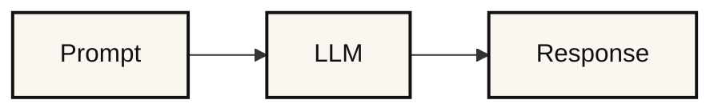
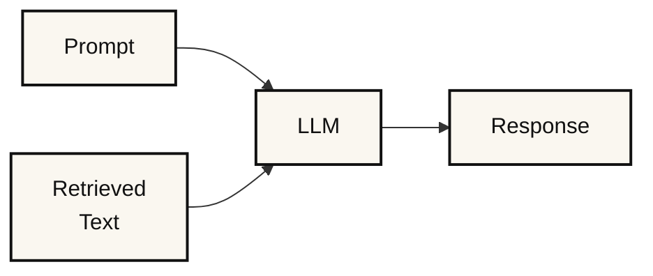
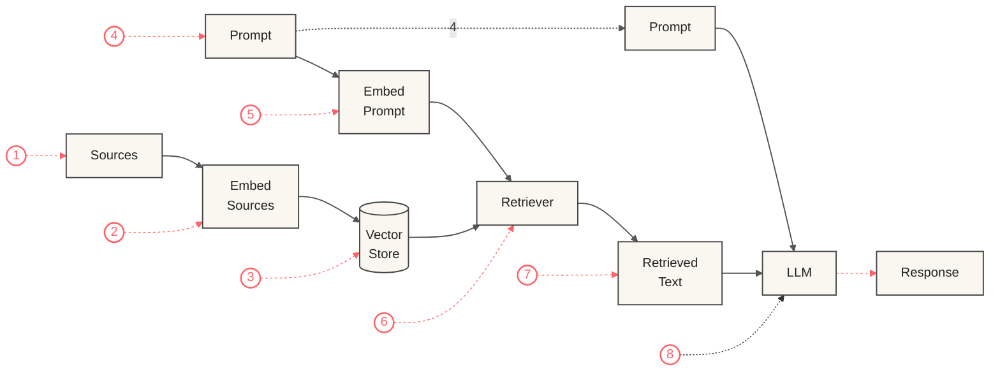

## What is RAG

Retrieval-Augmented Generation (RAG) is a machine-learning technique that integrates information retrieval with generative AI to produce accurate and context-aware responses. By equipping generative models, such as large language models (LLMs), with access to external data sources, RAG enhances the model's ability to provide relevant and helpful answers to user prompts or queries.

## Why RAG?

To understand the value of RAG, we need to consider the limitations of generative models that aren't part of a RAG system. The following image describes the response generation process of an LLM that is not part of a RAG pipeline:

LLMs embedded in such pipelines cannot access external sources and are limited to the information provided by the user in a prompt and the information the LLM was trained on. Consequently, these LLMs are prone to generating responses that may be:

1. Inaccurate,
2. Outdated, or
3. Fabricated ('hallucinations')

Additionally, such responses often lack valid sources, making it difficult to trace their origin or verify their accuracy. Now, consider a generative model integrated into an RAG system. The diagram below outlines the response generation component of such a system:

In an RAG system, the key addition is the retrieved text, which is sourced from an external data store. Steps are taken to ensure that the retrieved text aligns with the user's original prompt. This retrieved text is then combined with the original prompt using methods such as simple concatenation or a structured prompt template, where specific sections are filled with the original prompt and the retrieved text.

The result is an 'augmented prompt,' which merges the user's original prompt with the supplementary information provided by the retrieved text. The LLM then processes this augmented prompt, enabling it to generate a response that incorporates both the original prompt and the relevant additional context.

This approach addresses several key challenges:

1. **Enhanced response quality:** By incorporating relevant, retrieved data into the model's input, the system can deliver more accurate and detailed responses.
2. **Up-to-date information:** Unlike the model's static training data, external data can provide the system with current information, improving its ability to answer questions that require the latest insights.
3. **Verification of sources:** By citing specific external documents or sources, the system allows users to trace the information back to its origin, fostering greater trust and enabling users to verify the accuracy of the response.
## What about models with long context lengths?

RAG was developed and gained popularity during a period when models with large context lengths were uncommon. Today, models capable of handling context lengths up to 128,000 tokens or more are widely available. To put this into perspective, a token is a unit of text that can represent a word, part of a word, or even punctuation marks and spaces. Since tokens are not strictly equivalent to words, the ratio of tokens to words can vary. In English, a good estimate is that 100 tokens correspond to about 75 words. Based on this, a model with a 128,000-token context length can process an English text of approximately 96,000 words. This is long enough to include numerous relevant details within a prompt, providing the model with substantial contextual information.

However, relying solely on such extended context lengths presents several limitations:

1. **Input Dependency:** Users must already possess the necessary source information to provide within the prompt. Without this, the model cannot generate insights or solutions.
2. **Limited Capacity:** Although a 128,000-token capacity is significant, it may still fall short for extremely lengthy texts. For example, English translations of War and Peace by Leo Tolstoy generally exceed 560,000 words—more than five times this limit.
3. **Redundancy Issues:** Even when all relevant details fit within the prompt, irrelevant or repeated information can dilute the LLM's focus. This creates a "needle in a haystack" challenge for the model, as it must sift through vast data to extract critical facts.
4. **Processing Time:** Longer prompts require additional processing time. Since AI models analyze input by breaking it into tokens, more tokens result in longer processing times.
5. **Cost Implications:** Using a high number of tokens in prompts also increases both computational and financial costs, making this approach potentially less practical in some applications.

RAG helps address these challenges, either partially or fully:

1. **Input Dependency:** RAG connects to an external data store that users do not need to provide or even be aware of to interact successfully with the system.
2. **Limited Capacity:** RAG retrieves only the text most relevant to the prompt, creating smaller augmented prompts that fit within LLM context limits.
3. **Redundancy Issues:** RAG ensures only the most pertinent information is passed to the LLM, making it easier for the system to identify relevant details in source texts.
4. **Processing Time:** Shorter augmented prompts in RAG reduce the response generation time compared to non-RAG systems that include all available source information within the augmented prompt.
5. **Cost Implications:** By using shorter augmented prompts, RAG reduces response generation costs, especially for systems with extensive data sources.

## How does RAG work?

The following diagram illustrates the RAG process for a basic RAG system. Note that this is just one possible representation, and alternative diagrams may result from various modifications or adaptations of the RAG system. However, this diagram captures the core concept, as all variations build on the common themes presented here:

The steps in the RAG process are as follows:

1. **Gather Sources:** Start with sources like office documents, company policies, or any other relevant information that may provide context for the user's future prompt.
2. **Embed Sources:** Pass the gathered information through an embedding model. The embedding model converts each chunk of text into a vector representation, which is essentially a fixed-length column of numbers.
3. **Store Vectors:** Store the embedded source vectors in a vector store — a specialized database optimized for storing and manipulating vector data.
4. **Obtain a User's Prompt:** Receive a prompt from the user.
5. **Embed the User's Prompt:** Embed the user's prompt using the same embedding model used for the source documents. This produces a prompt embedding, which is a vector of numbers equal in length to the vectors representing the source embeddings.
6. **Retrieve Relevant Data:** Pass the prompt embedding to the retriever. The retriever also accesses the vector store to find and pull relevant source embeddings (vectors) that match the prompt embedding. The retriever's output is the retrieved text.
7. **Create an Augmented Prompt:** Combine the retrieved text with the user's original prompt to form an augmented prompt.
8. **Obtain a Response:** Feed the augmented prompt into a large language model (LLM), which processes it and produces a response.

## RAG Details

There are many nuances to each of the RAG steps highlighted above. Some of these details are elaborated on below:

**1. Gather Sources**

- Gathering sources often involves preprocessing the data before moving to the next step.
- Preprocessing may include converting source files into more machine-friendly formats (for example, turning PDFs into plain text) or utilizing dynamic preprocessing libraries before passing documents to the next phase.

**2. Embed Sources**

- Chunking: Large documents are split into smaller, manageable chunks to enable efficient retrieval.
- Embedding: Text chunks are processed by an embedding model, distinct from the LLM used for response generation. This embedding model transforms text chunks into fixed-length numeric vectors that capture their semantic meaning.
- Tokenization: Text is split into tokens (for example, words, parts of words, punctuation). Each token is assigned (encoded with) a unique numerical ID with no intrinsic meaning—IDs are consistent for the same token.
- Neural Network Processing: Token IDs are input into the embedding model's neural network, producing fixed-length vectors that encapsulate the text's semantic meaning.

**3. Store Vectors**

- Embedding vectors are stored for future retrieval.
- Simple systems use matrices, but most utilize specialized vector databases like ChromaDB, FAISS, or Milvus. Each database offers unique features and limitations.

**4. Obtain a User's Prompt**

- A user's prompt can either be standalone or incorporate prior conversation history.
- If a discussion history is included, conversation memory tools (for example, LangChain, LlamaIndex) help augment the current prompt with the relevant context.

**5. Embed the User's Prompt**

- The user's prompt is embedded using the same embedding model as the source documents, ensuring compatibility.

**6. Retrieve Relevant Data**

- Retrieving the most relevant text chunk.
- Fetching the entire document containing the relevant chunk.
- Retrieving multiple relevant documents.

**7. Create an Augmented Prompt**

- Augmented prompts merge the user's original query with retrieved data.
- Simple concatenation of the user's prompt with retrieved text.
- Using structured templates where different components (for example, user input, retrieved text) are placed alongside additional instructions for the LLM to follow.

**8. Obtain a Response**

- Responses can be further refined using predefined templates, ensuring a consistent presentation style tailored to the use case.

The many intricacies of each RAG step contribute to a wide range of implementation possibilities, enabling customization to suit various applications and needs.
